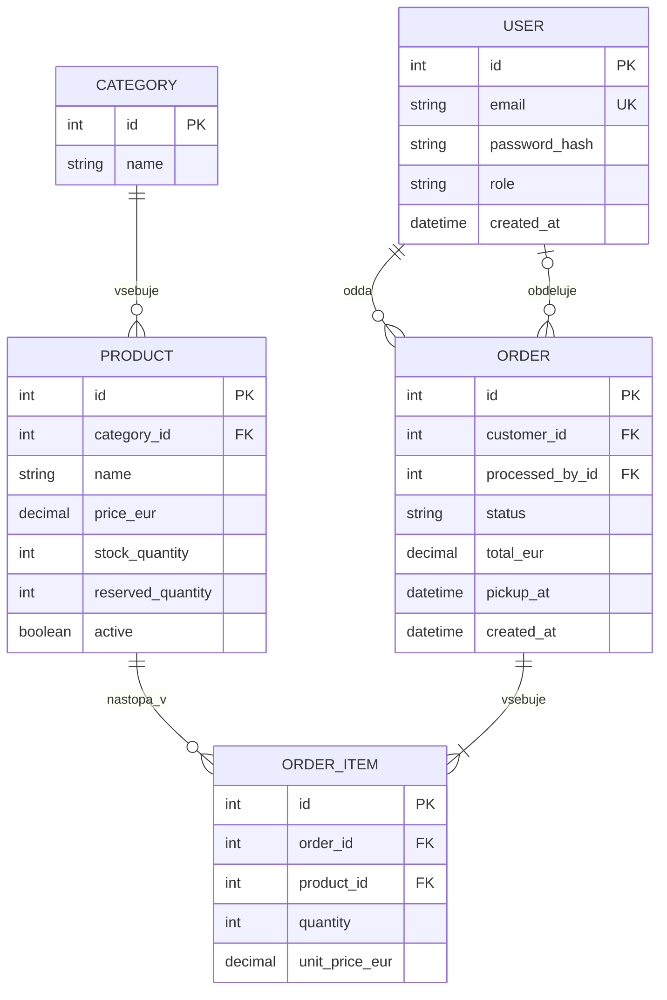

# Podatkovni model – KmetDirekt

## Izbira podatkovne baze

Uporabil bom PostgreSQL. Podatki imajo jasne povezave: kupec odda naročilo, naročilo vsebuje postavke, vsaka postavka pa se nanaša na izdelek. Pri rezervaciji zaloge bom potreboval tudi transakcije, da ne pride do napačnih količin, če se naročilo ne uspe shraniti.

## Glavne entitete

| Entiteta | Polja | Namen |
|---|---|---|
| `User` | `id` (PK), `email` (UNIQUE), `password_hash`, `role`, `created_at` | Uporabniški računi. `role` ima vrednosti `CUSTOMER`, `EMPLOYEE` ali `ADMIN`. |
| `Category` | `id` (PK), `name` | Kategorija mesnih paketov, npr. govedina. |
| `Product` | `id` (PK), `category_id` (FK), `name`, `description`, `price_eur`, `stock_quantity`, `reserved_quantity`, `active` | Izdelki, cene in zaloga. |
| `Order` | `id` (PK), `customer_id` (FK), `processed_by_id` (FK, neobvezno), `status`, `pickup_at`, `total_eur`, `created_at`, `updated_at` | Naročilo in njegovo stanje. |
| `OrderItem` | `id` (PK), `order_id` (FK), `product_id` (FK), `quantity`, `unit_price_eur` | Posamezen izdelek v naročilu. |

Cene bodo tipa `DECIMAL`, količine pa cela števila. Vlogo uporabnika bom za zdaj hranil neposredno v `User`, ker imamo samo tri stalne prijavljene vloge. Neprijavljeni obiskovalec ni zapis v `User` in nima dodeljene vloge: javno ponudbo lahko bere brez seje. Kategorije bodo v ločeni tabeli, ker jih bo lastnik lahko dodajal in spreminjal.

`stock_quantity` pomeni skupno fizično zalogo, `reserved_quantity` pa del te zaloge, ki je že rezerviran. Prosta zaloga se izračuna kot `stock_quantity - reserved_quantity`.

## ER-diagram

## Povezave med entitetami

- En kupec lahko odda več naročil, vsako naročilo pa pripada enemu kupcu.
- Naročilo lahko obdeluje en zaposleni, vendar zaposleni ob oddaji še ni nujno dodeljen (`processed_by_id` je lahko `NULL`).
- Ena kategorija lahko vsebuje več izdelkov, posamezen izdelek pa spada v eno kategorijo.
- Naročilo vsebuje eno ali več postavk. Posamezna postavka pripada enemu naročilu in enemu izdelku.
- Isti izdelek se lahko pojavi v več različnih naročilih.

## Pomembna pravila za podatke

- Cena ne sme biti negativna, količina postavke mora biti pozitivno celo število.
- `stock_quantity` ne sme biti negativna, `reserved_quantity` pa mora biti med 0 in `stock_quantity`.
- Ob oddaji naročila backend v transakciji zaklene ustrezne izdelke, preveri prosto zalogo, shrani naročilo in poveča rezervirano količino. Če katerikoli korak ne uspe, spremembe razveljavi.
- Ob zavrnitvi ali preklicu se rezervacija sprosti enkrat. Ob prevzemu se za prodane pakete zmanjšata fizična in rezervirana zaloga.
- Cena v `OrderItem` ostane takšna, kot je bila ob oddaji naročila, tudi če lastnik kasneje spremeni cenik.

Poleg poslovnih entitet bo PostgreSQL hranil tudi tehnično tabelo `session` (identifikator seje, vsebina seje in čas poteka), ki jo uporablja shramba strežniških sej. To ni tabela uporabniških vlog in zanjo ni potrebna povezava v poslovnem ER-diagramu. Ob vsaki zaščiteni zahtevi se iz seje ugotovi prijavljeni uporabnik, njegova vloga pa se preveri v `users`.

Kasneje bi lahko dodal tabele za zgodovino sprememb zaloge, razpoložljive termine prevzema in obvestila.
