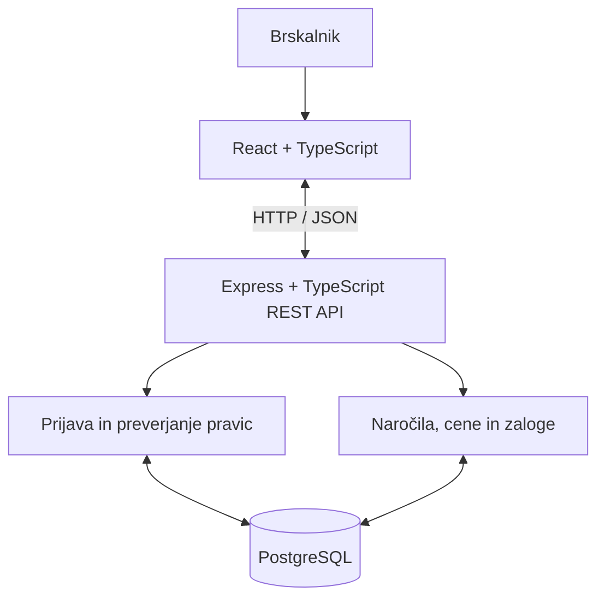

# Arhitektura in tehnološki sklad – KmetDirekt

## Kako bo aplikacija sestavljena?

Predvidel sem tri plasti. **React** bo skrbel za spletni vmesnik, **Express** za obdelavo zahtev in poslovna pravila, **PostgreSQL** pa za shranjevanje podatkov. Uporabnik bo dostopal do aplikacije v brskalniku. React bo pošiljal HTTP zahteve na REST API, backend pa bo po potrebi izvedel SQL poizvedbe.

Backend bo ena aplikacija, notranje razdeljena na module `auth`, `products` in `orders` (modularni monolit). Tako ne potrebujem več ločenih strežniških storitev.

## Tehnologije

| Del | Izbira |
|---|---|
| Frontend | React, TypeScript, Vite |
| Backend | Node.js, Express, TypeScript |
| API | REST, JSON |
| Podatkovna baza | PostgreSQL |
| Dostop do baze | `pg` in parametrizirane SQL poizvedbe |
| Prijava | Argon2id, `express-session` in `connect-pg-simple` za strežniške seje v PostgreSQL |
| Preverjanje pravic | Javni gost brez seje; tri prijavljene vloge (RBAC) in preverjanje lastništva naročila |
| Lokalni razvoj | VS Code, Node.js, npm, Docker Compose |
| Testiranje API-ja | Postman |
| Testni podatki | Za nadaljnje vaje Python in Faker |
| Verzije kode | Git |

TypeScript bom uporabljal na obeh straneh. Backend se pred zagonom prevede v JavaScript, ki ga izvede Node.js. Ker TypeScript preverja tipe pred izvajanjem, mora backend še vedno sam preveriti dejanske podatke v HTTP zahtevah.

## Osnovne API poti

| Zahteva | Namen |
|---|---|
| `POST /api/login` | Prijava uporabnika in vzpostavitev seje |
| `POST /api/logout` | Odjava in uničenje seje |
| `GET /api/me` | Podatki o trenutno prijavljenem uporabniku |
| `GET /api/products` | Javni prikaz ponudbe tudi brez prijave |
| `POST /api/orders` | Oddaja naročila in rezervacija zaloge |
| `GET /api/orders/my` | Kupčeva naročila |
| `PATCH /api/orders/:id/confirm` | Potrditev naročila |
| `PATCH /api/orders/:id/reject` | Zavrnitev in sprostitev rezervacije |
| `PATCH /api/orders/:id/prepare` | Oznaka, da je naročilo pripravljeno |
| `PATCH /api/orders/:id/complete` | Evidentiranje prevzema |
| `PATCH /api/orders/:id/cancel` | Preklic naročila |

Potrditev, zavrnitev, pripravo in prevzem lahko izvaja zaposleni. Preklic lahko zahteva kupec za svoje naročilo, dokler priprava še ni začeta. Na backendu se preverjata tako uporabniška vloga kot dovoljen status naročila.

## Prijava, seje in preverjanje pravic

Neprijavljen obiskovalec lahko brez seje uporablja javno pot `GET /api/products`. Ni zapisan kot četrta vloga v tabeli `users`. Za oddajo naročila ali dostop do lastnih naročil je potrebna prijava. V MVP bodo računi pripravljeni vnaprej in ne bo javne registracije.

1. Uporabnik pošlje e-pošto in geslo na `POST /api/login`.
2. Express poišče uporabnika v PostgreSQL in primerja geslo z zgoščeno vrednostjo `password_hash` (Argon2id). Če podatki niso pravilni, vrne `401 Unauthorized`.
3. Ob uspešni prijavi sistem obnovi identifikator seje (za zaščito pred *session fixation*) in ustvari sejo prek `express-session`; `connect-pg-simple` shrani podatke seje v PostgreSQL. V seji je samo ID uporabnika, ne geslo.
4. Brskalnik prejme sejni identifikator v piškotku `HttpOnly`; pri naslednjih zahtevah ga samodejno pošilja strežniku. Backend iz seje pridobi ID uporabnika in iz baze njegovo trenutno vlogo.
5. Middleware `requireAuth` zavrne neprijavljeno zahtevo z `401`, `requireRole('EMPLOYEE')` oziroma podobno preverjanje pa nepravilno vlogo z `403 Forbidden`. Pri naročilih kupca backend poleg vloge preveri, ali `order.customer_id` ustreza prijavljenemu uporabniku.
6. Ob `POST /api/logout` strežnik uniči sejo in izbriše sejni piškotek.

| Operacija | Kdo jo lahko izvede | Preverjanje na backendu |
|---|---|---|
| `GET /api/products` | Vsi, tudi neprijavljeni | Brez seje; prikažejo se samo aktivni izdelki in javna polja. |
| `POST /api/orders` | `CUSTOMER` | Veljavna seja in vloga kupca; izračun cene ter preverjanje zaloge. |
| `GET /api/orders/my` | `CUSTOMER` | Poizvedba je omejena na `customer_id` iz seje, ne iz uporabniškega vnosa. |
| `PATCH /api/orders/:id/cancel` | `CUSTOMER` | Lastništvo naročila in dovoljen trenutni status. |
| `PATCH /api/orders/:id/confirm` | `EMPLOYEE` | Prijavljena vloga zaposlenega in ustrezen status naročila. |
| Upravljanje ponudbe (kasneje) | `ADMIN` | Vloga administratorja. |

Dovoljene vloge so `CUSTOMER`, `EMPLOYEE` in `ADMIN`. Administrator v MVP ni avtomatično upravičen izvajati vsake operacije kupca ali zaposlenega; pravice se določijo za posamezno pot. Vloge se preverjajo iz zaupanja vrednih strežniških podatkov, ne iz polja, ki ga pošlje brskalnik.

Za sejni piškotek uporabim `HttpOnly`, `SameSite=Lax` in v produkciji prek HTTPS tudi `Secure`. Zahteve, ki spreminjajo podatke, zaščitim pred CSRF (npr. s preverjanjem CSRF žetona in izvora zahtev); nastavitev `SameSite` sama po sebi ni zadostna zaščita. V produkciji bosta frontend in API pod istim izvorom. Med lokalnim razvojem lahko Vite posreduje klice `/api` backendu, da je delo s piškotki preprostejše. Skrivnosti in podatki za povezavo z bazo so v `.env`, ki ni objavljen v Gitu.

## Lokalni zagon (predviden)

1. Namestim Node.js in Docker ter pripravim `.env` s podatki za povezavo z bazo in skrivnostjo sej. Te datoteke ne shranim v Git.
2. Z `docker compose up --build -d` zaženem PostgreSQL in Express. Pri gradnji Docker slike se backend TypeScript prevede v JavaScript.
3. Inicializiram tabele in dodam nekaj testnih izdelkov ter uporabnikov.
4. V mapi `frontend` zaženem `npm install` in `npm run dev`.
5. V brskalniku odprem naslov, ki ga izpiše Vite. API bo na nastavljenih vratih, na primer `localhost:3000`.

PostgreSQL bo uporabljal Docker volume, zato podatki ostanejo shranjeni tudi po ustavitvi zabojnika. Za ločeno Docker nalogo bom pripravil Dockerfile za backend in bazo ter objavil verzionirani sliki v Docker Hub.

## Arhitekturne odločitve

| Odločitev | Zakaj sem jo izbral | Kaj bi lahko uporabil drugače? |
|---|---|---|
| **Spletna aplikacija** | Kupci in zaposleni jo lahko uporabljajo v brskalniku brez namestitve. | Namenska mobilna aplikacija bi zahtevala ločen razvoj. |
| **Tri plasti** | Vmesnik, poslovna pravila in podatki imajo ločene naloge. Backend lahko preverja cene in pravice, ne da bi zaupal brskalniku. | Neposrednega dostopa odjemalca do baze z aplikacijskimi poverilnicami ne želim. |
| **Modularni monolit** | Gre za majhen projekt, ki ga razvijam sam. Moduli pomagajo organizirati kodo, aplikacija pa ostane enostavna za zagon. | Mikroservisi bi zahtevali več infrastrukture in komunikacije. |
| **React + TypeScript + Vite** | React ustreza interaktivni košarici in pregledom naročil. TypeScript pomaga najti napake v tipih, Vite pa olajša razvoj. | Navaden JavaScript bi zahteval manj začetne nastavitve, a ne bi ponujal statičnega preverjanja tipov. |
| **Node.js + Express + TypeScript** | Express zadostuje za manjši REST API. Na frontendu in backendu lahko uporabljam TypeScript in po potrebi skupne tipe. | FastAPI bi bil dobra možnost v Pythonu, NestJS pa bi prinesel več vnaprej določene strukture. |
| **REST in JSON** | Za izdelke in naročila imam nekaj jasnih API poti, ki jih lahko preizkusim tudi s Postmanom. | GraphQL bi imel več smisla pri zahtevnejšem pridobivanju podatkov. |
| **PostgreSQL** | Naročila, uporabniki in izdelki so povezani. Tuji ključi in transakcije pomagajo ohranjati pravilne podatke. | MongoDB bi bil mogoč, vendar dokumentni model tu ne prinaša posebne prednosti. |
| **Knjižnica `pg`** | Ker je poizvedb razmeroma malo, jih lahko napišem neposredno v SQL. Parametri zaščitijo vrednosti pred SQL injection. | ORM, npr. Prisma, bi zmanjšal del ročnega pisanja SQL, vendar bi dodal novo orodje. |
| **Strežniške seje** | `express-session` in shramba v PostgreSQL omogočata preverjanje ter preklic prijave. Brskalnik prejme samo `HttpOnly` sejni piškotek. | JWT bi bil možen, vendar za ta primer ne potrebujem dodatnega upravljanja žetonov. |
| **Javni obiskovalec in tri vloge (RBAC)** | Neprijavljeni obiskovalec lahko bere ponudbo; kupec, zaposleni in lastnik imajo različne pravice. Middleware na backendu preverja sejo, vlogo in pri naročilih še lastništvo. | Bolj podroben sistem pravic bi bil za eno kmetijo odveč. |
| **Paketi v celih kosih** | Zalogo lahko vodim v celih številih, brez tehtanja pri spletnem naročilu. | Poljubna teža bi zahtevala dodatna pravila glede merskih enot in zaokroževanja. |
| **Cena na backendu** | Kupec ne sme sam določiti cene. Ob oddaji shranim takratno ceno vsake postavke. | Izračun v Reactu je primeren samo za informativni prikaz. |
| **Transakcije za rezervacijo** | Naročilo in rezervacija zaloge morata uspeti skupaj. Uporabil bom tudi zaklepanje ustreznih vrstic izdelkov. | Brez transakcije bi lahko ostala rezervacija brez naročila. |
| **Docker Compose** | Backend in bazo lahko zaženem skupaj in ponovljivo. Baza bo imela trajno shrambo. | Ročna namestitev baze je mogoča, a manj priročna pri ponovnem zagonu projekta. |
| **Majhen MVP** | Osredotočim se na naročanje in osebni prevzem pri eni kmetiji, da projekt ostane izvedljiv. | Plačila, dostava in dodatne integracije lahko počakajo. |

## Posebnost pri rezervaciji zaloge

Za vsak izdelek bom vodil fizično (`stock_quantity`) in rezervirano (`reserved_quantity`) količino. Prosta zaloga je njuna razlika. Pri naročilu backend v eni transakciji zaklene potrebne vrstice izdelkov, preveri količine in shrani naročilo s postavkami. Če nečesa ni dovolj, izvede `ROLLBACK`.

Ob zavrnitvi ali pravočasnem preklicu se rezervacija sprosti. Ob prevzemu se zmanjšata fizična in rezervirana zaloga. Statusi se prav tako preverjajo v transakciji, da istega naročila ne bi dvakrat zaključili ali dvakrat sprostili rezervacije.

Za prvo različico bom katalog in tri vrste uporabniških računov ustvaril s testno skripto. Administratorski obrazci za urejanje ponudbe in računov so načrtovani za poznejšo različico.
