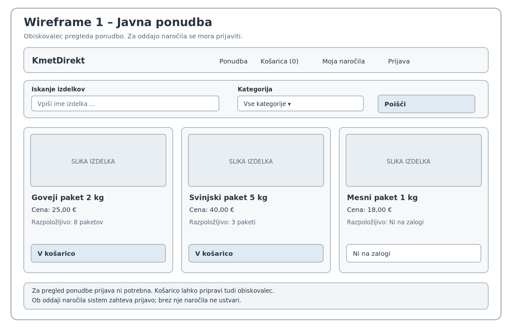
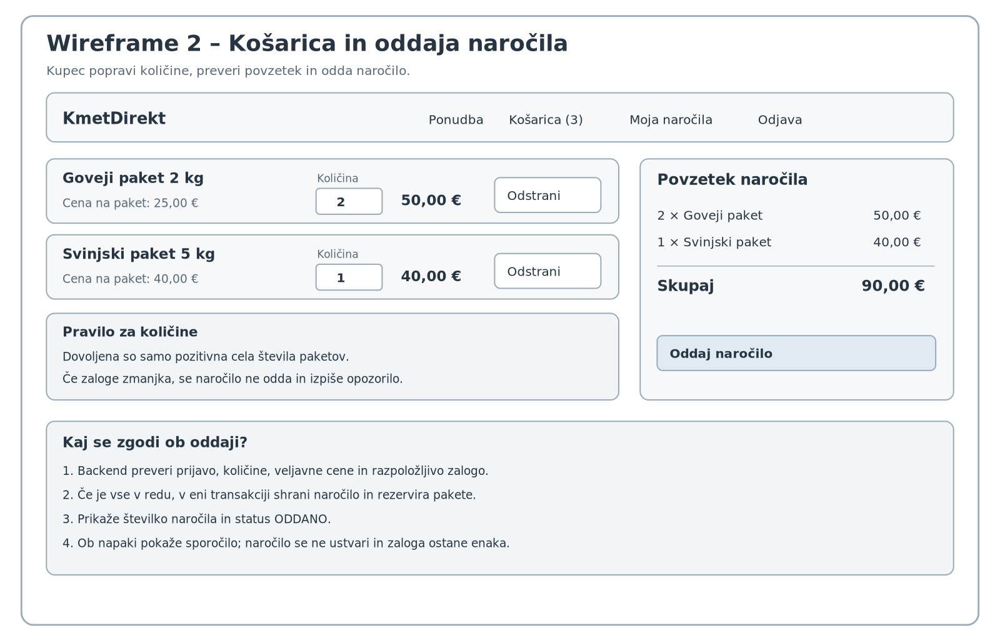
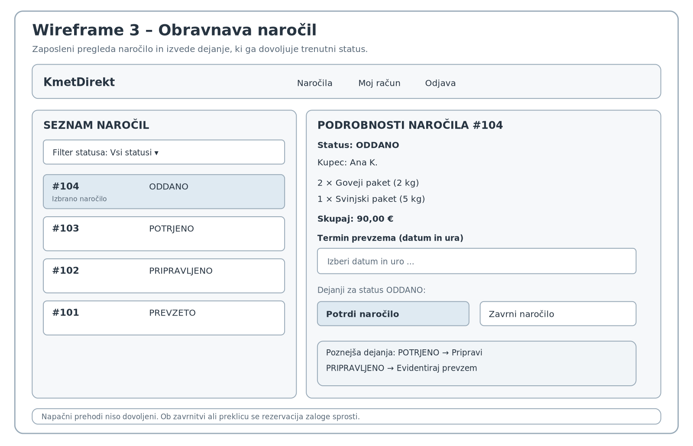

# Wireframe-i – KmetDirekt

Pripravil sem tri skice glavnih zaslonov. Gre za osnutke razporeditve in uporabniških dejanj, ne za končno grafično podobo. Prikazani izdelki, cene in naročila so primeri.

## 1. Javna ponudba

Začetna stran prikazuje izdelke, njihove cene in prosto zalogo. Obiskovalec lahko uporabi iskalnik in filter kategorij. Dodal sem tudi primer izdelka, ki ni na zalogi – pri njem gumb za dodajanje ni aktiven. Košarico je mogoče pripraviti tudi brez prijave, vendar je za oddajo naročila potrebna prijava. Povezava: **US-07, US-08 in US-01**.

## 2. Košarica in oddaja naročila

Kupec vidi oba izbrana izdelka, spreminja količine in lahko posamezno postavko odstrani. Desno je povzetek s skupnim zneskom. Dodal sem prostor za opozorila ter opis odziva po uspešni ali neuspešni oddaji. Izračun cene ostaja del oddaje naročila, ne samostojna funkcionalnost. Povezava: **US-01 in US-02**.

## 3. Obravnava naročil

Levo je seznam naročil s statusi in možnostjo filtriranja. Desno so podrobnosti izbranega naročila, njegov status in vnos termina prevzema. Za naročilo `ODDANO` sta prikazani dejanji *Potrdi naročilo* in *Zavrni naročilo*. Ko je naročilo že potrjeno, se namesto njiju ponudi priprava, pri pripravljenem naročilu pa evidentiranje prevzema. Povezava: **US-03, US-04 in US-05**.

## Opombe o obsegu

Vsi trije wireframe-i prikazujejo **MVP**. Iskanje, filtriranje in odstranjevanje postavk so predlagane podrobnosti vmesnika, ne dodatni samostojni poslovni procesi. Za izvedbo ostaja pomembno, da backend preverja prijavo, zalogo in dovoljene spremembe statusa; sama skica tega ne zagotavlja.

Predvideno je, da termin ob potrditvi vnese zaposleni, ne kupec. Samostojna izbira termina kupca ostaja načrtovana nadgradnja (US-12). Javna registracija, spletno plačilo in dostava niso vključeni v MVP.
